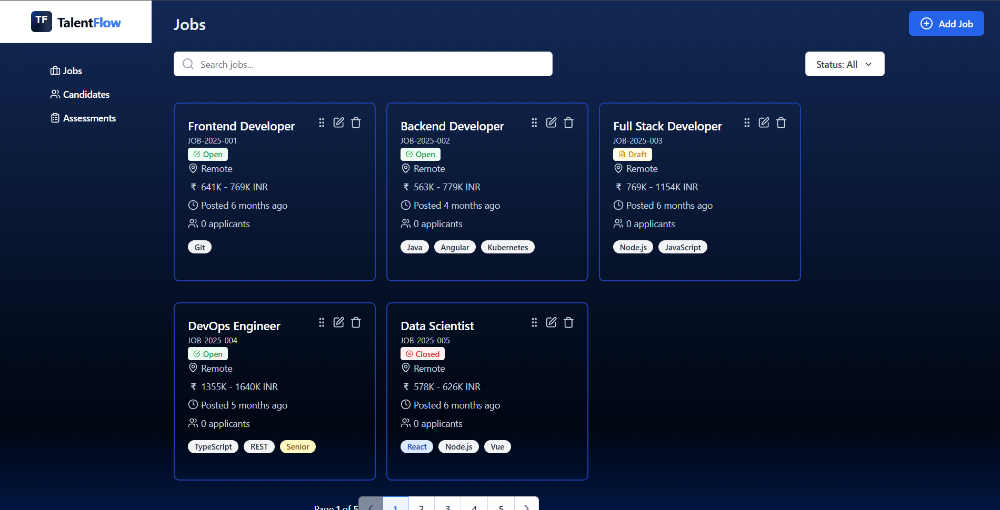
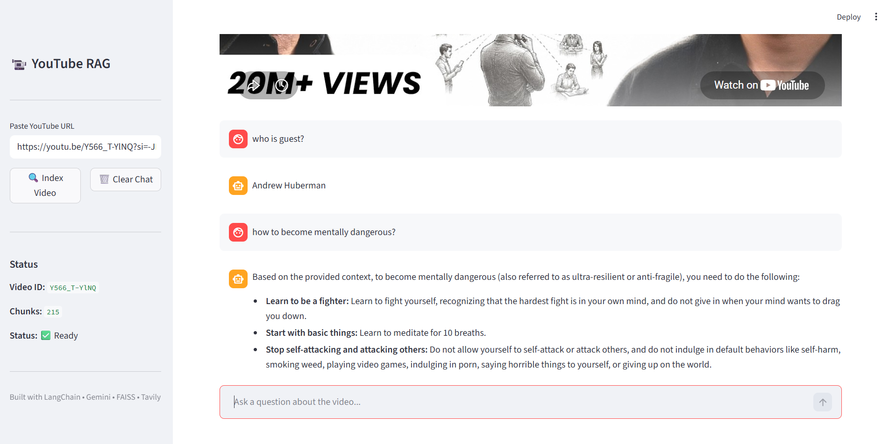

# 👋 Hey, I'm Abhishek Kumar Gupta

### Software Engineer | Backend & Data Engineering | Applied AI

I build practical software solutions at the intersection of backend engineering, data systems and AI-powered applications.

💼 Framework Engineer @ Quantiphi  
🐍 Python • SQL • Backend Development  
☁️ Google Cloud • Data Engineering  
🤖 LLMs • RAG • AI Application Development  
⚡ 650+ DSA Problems Solved

---

## 🚀 Featured Projects

### 01. TalentFlow — Recruitment Management Platform

A modern recruitment management platform designed to streamline hiring workflows through an interactive dashboard and modular application architecture.

- Job management with search, status filtering and pagination.
- Candidate and assessment management workflows.
- Reusable components and centralized state management.
- Offline-first persistence using IndexedDB.
- Responsive UI built with React and Tailwind CSS.

**Tech:** React.js · Zustand · Tailwind CSS · IndexedDB

### 02. YouTube Video Q&A — RAG-Powered AI Application

An AI-powered application that transforms YouTube videos into interactive knowledge bases, allowing users to ask questions and receive context-aware answers.

- Extracts and processes YouTube video transcripts.
- Splits content into searchable chunks.
- Uses FAISS for semantic vector retrieval.
- Integrates Gemini for context-aware answer generation.
- Orchestrates retrieval workflows using LangChain.

**Tech:** Python · LangChain · Gemini · FAISS · Tavily

### 03. Blogging WebApp — AI-Enhanced Blogging Platform

A full-stack blogging application combining content management with AI-powered assistance.

- Interactive frontend using React.js.
- Centralized state management with Redux Toolkit.
- Backend integration using Appwrite.
- Gemini-powered AI assistance.
- Responsive interface with Tailwind CSS.

**Tech:** React.js · Redux Toolkit · Appwrite · Gemini · Tailwind CSS

### 04. Library Management System

A database-driven application designed to simplify library operations and resource management.

- Object-oriented application architecture.
- MySQL integration and structured data management.
- Modular implementation of library operations.

**Tech:** C++ · MySQL · SQL · OOP

---

## 💼 Professional Experience

**Framework Engineer | Quantiphi**  
`July 2026 – Present`

- Developing reusable Python components and data processing workflows.
- Implementing SQL-based transaction processing and idempotent operations.
- Working on data validation, reconciliation and quality checks.
- Exploring GCP, BigQuery, Cloud Storage and Terraform.

**Web Development | IIT Guwahati**  
`December 2024 – February 2025`

- Developed frontend components using React.js.
- Worked with Supabase authentication and application workflows.

**Firmware Developer | Smart India Hackathon 2024**

- Contributed to the technical development of the hackathon solution.

---

## 🛠️ Tech Stack

| Category | Technologies |
|---|---|
| Languages | Python, C++, C, JavaScript, SQL |
| Backend | FastAPI, Node.js, Express.js, REST APIs |
| Frontend | React.js, Redux Toolkit, Zustand, Tailwind CSS |
| Data Engineering | BigQuery, PySpark, Apache Airflow, dbt, MySQL |
| AI & LLMs | LangChain, RAG, Gemini, OpenAI APIs, Hugging Face, FAISS |
| Cloud & DevOps | Google Cloud, Terraform, Docker, Git, GitHub |

---

## 🎓 Education

**National Institute of Technology, Srinagar**

B.Tech — Electronics and Communication Engineering  
**CGPA: 8.06 / 10** | 2022–2026

**Class XII — CBSE:** 95.2%

---

## 🏆 Achievements & Leadership

- 🥇 Smart India Hackathon 2024 — Finalist
- 🚀 ISRO URSC — Stage-1 Qualifier
- 💻 Solved 650+ Data Structures & Algorithms problems.
- 🌐 Web Development Officer — IET, DEVX SIG.

---

## 📜 Certifications

| Certification | Issuer | Credential |
|---|---|---|
| Associate Data Practitioner Certification | Google Cloud | [Verify ↗](https://www.credly.com/badges/e246386f-ca9a-44be-8c44-2ec09656da06/public_url) |
| OpenAI Foundational Knowledge | OpenAI | [Verify ↗](https://oaipartnernetwork.credential.net/0039a3a0-c326-487c-a5f5-9c5d33628eba) |
| OpenAI Technical Practitioner | OpenAI | [Verify ↗](https://oaipartnernetwork.credential.net/acd8da3d-2104-4b70-aba7-e5f14cb9210d) |

---

## 📊 GitHub Analytics

  
  

  

---

## 🏅 Holopin Achievements

---

## 🤝 Let's Connect

  
  

  <i>"Curious by nature. Engineer by choice. Builder by passion."</i>

⭐ If you find something interesting, explore my repositories and consider giving them a star!

